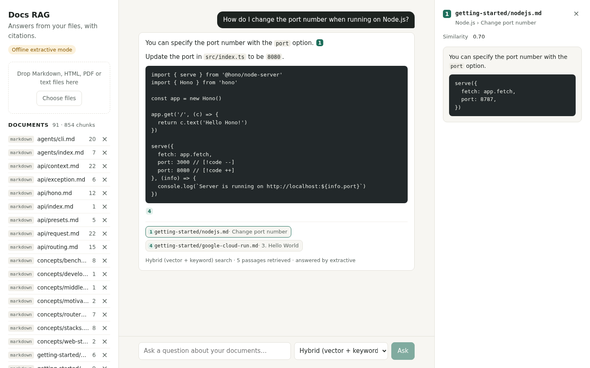

# docs-rag-citations

Ask questions about your own Markdown, HTML, PDF and text files and get answers that cite the
passage they came from. When the documents don't cover a question, the app says
"I don't know" instead of guessing. It ships with a retrieval eval that measures how often the
right passage is found.

This is a personal portfolio project by Sunnatulla E. It is not a product and has no users. The
sample corpus is the open-source [Hono](https://hono.dev) documentation (MIT), used only as test
data.



## Features

- **Ingest** Markdown, HTML, PDF (page numbers kept) and plain text. Chunks overlap, never cross
  a heading, and keep their heading trail, so every citation points to one section and page.
- **Local embeddings** with `Xenova/all-MiniLM-L6-v2` through transformers.js. No API key is
  needed to index or search.
- **Postgres in-process**: PGlite with pgvector. HNSW index for vectors, GIN index for full
  text. The SQL is plain Postgres, so it moves to Supabase unchanged (see below).
- **Hybrid search**: pgvector cosine search and Postgres full-text search, merged with
  reciprocal rank fusion in one SQL query. Vector-only and keyword-only modes are there for
  comparison.
- **Answers with citations**: Claude (`claude-haiku-5-5` by default) answers only from the
  numbered sources and cites them as `[n]`. Markers that point to no source are removed, and an
  answer that cites nothing counts as a refusal.
- **Refusals**: if no retrieved chunk is similar enough to the question, the app answers
  "I don't know based on the provided documents." without calling the model.
- **Offline mode**: without an API key, a deterministic extractive answerer quotes the best
  matching passages (and their code samples) with citations, so the app, the tests and the eval
  all run for free.
- **Chat UI** (React + Vite): upload by drag and drop, ask, click a citation chip to read the
  source passage with its heading trail, page and similarity. Works on phones too.
- **Eval**: 30 hand-written questions over the Hono docs, reporting hit@1, hit@5, MRR@10 and
  refusal accuracy.

## Eval results

Measured with `npm run eval` on the Hono docs (91 Markdown files, 854 chunks) and 30 questions:
24 that the docs answer and 6 they don't. A question counts as found when a retrieved chunk is
from the right file and contains a phrase that answers it (`eval/questions.json`). The full
report is in [eval/results.md](eval/results.md).

| Search mode | hit@1 | hit@5 | MRR@10 |
| --- | --- | --- | --- |
| Vector only (pgvector) | 38% | 63% | 0.509 |
| Keyword only (Postgres full text) | 21% | 71% | 0.411 |
| **Hybrid (RRF)** | **50%** | **83%** | **0.632** |

End to end, with hybrid search and the offline extractive answerer:

| Metric | Result |
| --- | --- |
| Questions the docs don't cover, refused | 6/6 |
| Answerable questions wrongly refused | 5/24 |
| Answers citing a chunk that contains the answer | 12/24 |
| Answers citing the right file | 17/24 |
| Refusal accuracy, all 30 questions | 83% |

Read these numbers with care:

- 30 questions is a small set, and I wrote the questions myself.
- The refusal thresholds (cosine 0.4, term coverage 0.4) were chosen by looking at this same
  set, so the refusal numbers are optimistic. There is no held-out split.
- The end-to-end numbers are for the extractive answerer. It can only quote, so it misses
  answers an LLM would put together from two passages. The Claude path is unit-tested with a
  mocked client but was not part of this eval run.
- The eval is deterministic: running it twice gives the same report.

## How it works

```
upload ─► loader (md/html/pdf/txt) ─► sections with heading trail + page
        ─► chunker (≤160 words, 32-word overlap) ─► MiniLM embeddings
        ─► PGlite: documents, chunks(embedding vector(384), fts tsvector)

question ─► embed ─► hybrid SQL: top 20 by cosine + top 20 by ts_rank_cd ─► RRF ─► top 5
         ─► best cosine < 0.4? ─► "I don't know"
         ─► answerer (Claude or extractive) ─► keep valid [n] markers ─► answer + sources
```

| Path | What it does |
| --- | --- |
| `src/ingest/` | Loaders and chunker |
| `src/embedder.ts` | Local sentence embeddings |
| `src/store.ts` | Schema, inserts and the three search queries |
| `src/library.ts` | Ingest pipeline and `ask()` |
| `src/answer/` | Claude answerer, extractive answerer, citation handling |
| `src/server.ts` | Hono JSON API |
| `web/` | React chat UI |
| `eval/` | Questions, corpus, runner and results |
| `supabase/migration.sql` | The same schema and search for Supabase |

## Run it

Needs Node.js 22 or newer.

```sh
npm install
npm run build                      # server (dist/) and UI (web/dist/)
npm start                          # http://127.0.0.1:8787
```

The first start downloads the embedding model (about 23 MB) and caches it. Upload files in the
UI, or index a folder from the command line:

```sh
node dist/cli.js ingest ./my-docs  # folders are walked recursively
node dist/cli.js ask "How do I change the port?"
node dist/cli.js search "port" --mode vector --limit 5
```

To get Claude answers, copy `.env.example` to `.env` and set `ANTHROPIC_API_KEY`
(`ANSWER_MODEL` picks the model). Without a key the app runs in offline extractive mode, and the
UI shows which mode is active.

Development: `npm run dev:api` and `npm run dev:web` (Vite proxies `/api` to the API).

## API

| Method and path | Body | Result |
| --- | --- | --- |
| `GET /api/health` | | Answer engine, model, document count |
| `GET /api/documents` | | Documents with chunk counts |
| `POST /api/documents` | multipart, field `file` (one or more) | `201` with the stored documents |
| `DELETE /api/documents/:id` | | `204`, or `404` |
| `POST /api/ask` | `{ "question": "...", "mode": "hybrid" }` | Answer, refused flag, cited numbers, sources |

Errors come back as `{ "error": "..." }` with `400`, `404`, `413` (upload over 20 MB), `415`
(unsupported file), `422` (no text, e.g. a scanned PDF) or `502` (Claude API failure). If one
file in an upload is unsupported, none of them are ingested.

## Moving from PGlite to Supabase pgvector

PGlite keeps the demo self-contained: Postgres runs inside the Node process and needs no server
or Docker. The schema and queries are standard Postgres with pgvector, so production can use
Supabase or any managed Postgres instead.

1. Run [`supabase/migration.sql`](supabase/migration.sql) in the Supabase SQL editor (or as a
   migration). It creates the tables, the HNSW and GIN indexes and a `hybrid_search` function
   that does the same RRF ranking as `src/store.ts`. A test (`test/migration.test.ts`) runs this
   file in PGlite and checks the ranking.
2. Replace the PGlite client in `src/store.ts` with `pg` (or `postgres`) pointed at the Supabase
   connection string. The queries keep their `$n` parameters, so they work as they are.
3. Or search from an edge function or the browser with
   `supabase.rpc('hybrid_search', { query_text, query_embedding, match_count: 5 })`.
4. Turn on row level security policies for your users before storing real documents. The
   migration enables RLS on both tables, so nothing is readable through the Supabase API until
   you add policies.

## Tests

```sh
npm run check     # typecheck (server, tests, UI), ESLint, 54 Vitest tests, build
npm run e2e       # Playwright: upload → ask → click citation, refusal, bad upload
npm run eval      # writes eval/results.md and eval/results.json (about 2 minutes)
```

Playwright uses its own Chromium (`npx playwright install chromium`), or an installed Chrome
via `CHROME_PATH=/path/to/chrome npm run e2e`.

## Limitations

- One shared document library, no user accounts. Put it behind auth before exposing it.
- Scanned PDFs need OCR first; the PDF loader only reads the text layer.
- MiniLM is a small English model. A larger or multilingual embedding model would likely find
  more, at the cost of speed.
- The extractive answerer sometimes quotes a second, less relevant passage. Claude mode writes
  a proper answer.

## License

MIT, see [LICENSE](LICENSE). The eval corpus in `eval/corpus/hono-docs` is copied from
[honojs/website](https://github.com/honojs/website) at commit `20aab4e` under its MIT license,
included as `eval/corpus/hono-docs/LICENSE`.
